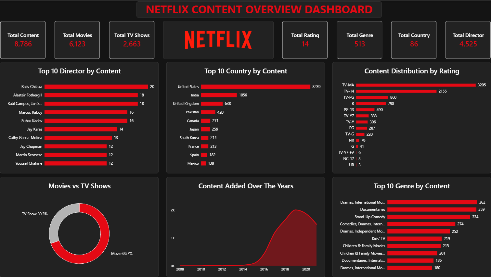
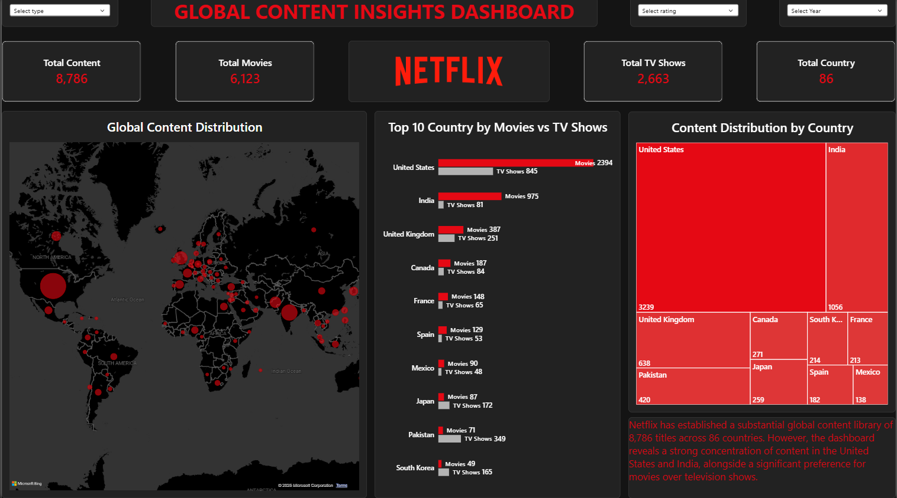
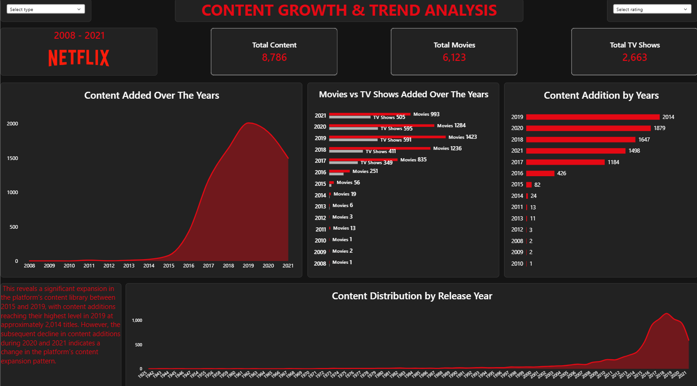
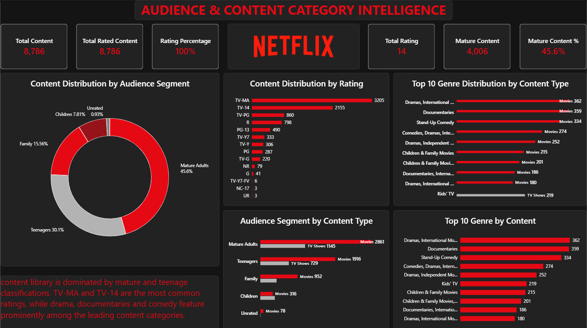

# NETFLIX DATA ANALYSIS w/ Power  BI 

## Introduction

The Netflix Dataset Analysis project is an end-to-end Business Intelligence and Data Analytics project developed using Microsoft Power BI to explore and evaluate the composition, distribution, and growth patterns of Netflix's content library. The project focuses on transforming raw entertainment data into meaningful business insights that support content portfolio evaluation, geographical analysis, audience classification, and strategic decision-making.

The analysis covers approximately 8,786 titles, comprising 6,123 movies and 2,663 TV shows, with multiple dimensions examined to understand the platform's content structure and distribution.

The project is organised into interconnected analytical dashboards, each addressing a specific business objective.

## Skills Showcased

-  **Data Transformation (ETL) with Power Query:** Cleaned, shaped and prepared the raw data for analysis by handling blanks, changing data types and creating new columns.
- **DAX Calculations:** Formulated measured to derive key insight and KPIs.
-  **Core Chart:** Utilized **Bar, Line, Map, Matrix** and **Donut Charts**.
- **KPI Indicator :** Used **Cards** to display key metrics.
- **Dashboard Design:** Designed an intuitive and visually appealling layout, exploring both common and uncommon chart types to best tell the data story.
- **Interactive Reporting:**
  - **Slicers:** To dynamically filter the report by year.
  - **Bookmarks:** To create a seamless navigation experience.

## Tools and Technologies

-  **Microsoft Excel:** Data inspection and preliminary  analysis
-  **Power Query:** Data cleaning and transformation
-  **Power BI:** DAX calculations and interactive dashboard development

  ## Dashboard Overview

  ### Page 1: Netflix Content Overview Dashboard

  
The Netflix Content Overview Dashboard provides a consolidated view of the platform's content portfolio, revealing the dominance of movies, the significant contribution of the United States, the concentration of titles within particular maturity ratings, and the historical pattern of content additions.

The findings demonstrate how data analytics and business intelligence tools can transform raw content data into meaningful insights that support strategic discussions around content diversification, geographical representation, and portfolio management.

This project demonstrates the practical application of Power BI in developing interactive dashboards and communicating data-driven business insights.

  
  ### Page 2: Global Content Insights Dashboard 

    

Netflix has established a substantial global content library of 8,786 titles across 86 countries. However, the dashboard reveals a strong concentration of content in the United States and India, alongside a significant preference for movies over television shows.

To strengthen its competitive position in the global streaming industry, Netflix should focus on geographical diversification, increased investment in original TV series, and the development of locally relevant content in emerging markets.

These strategies could help Netflix improve content diversity, reach new audiences and strengthen its long-term global growth opportunities.

  ### Page 3: Content Growth & Trend Analysis
     

  

The Netflix Content Growth and Trend Analysis reveals a significant expansion in the platform's content library between 2015 and 2019, with content additions reaching their highest level in 2019 at approximately 2,014 titles. However, the subsequent decline in content additions during 2020 and 2021 indicates a change in the platform's content expansion pattern.

The analysis also reveals that movies dominate the content portfolio, accounting for approximately 69.7% of the total 8,786 titles, while TV shows contribute 30.3%. Both content categories experienced substantial growth during the expansion period, although movie additions remained considerably higher.

Furthermore, the release-year distribution indicates that Netflix's library contains a strong concentration of relatively recent productions, while older titles continue to contribute to the overall catalogue.

From a strategic perspective, Netflix should evaluate the factors influencing its changing content acquisition patterns, maintain a balanced portfolio between movies and TV shows, and continuously assess audience preferences to guide future content investment decisions.

  ### Page 4: Audience & Content Category Intelligence

  

The Netflix Audience and Content Intelligence Dashboard reveals a content library dominated by mature and teenage classifications, which together account for approximately 75.7% of the total content portfolio. TV-MA and TV-14 are the most common ratings, while drama, documentaries and comedy feature prominently among the leading content categories.

The analysis also indicates that movies represent a larger proportion of the portfolio than TV shows across the major audience segments. Meanwhile, children's and family-oriented content occupy comparatively smaller portions of the library, presenting potential opportunities for content diversification.

From a strategic perspective, Netflix should continuously evaluate its content distribution across audience segments, ratings and genres to maintain a balanced portfolio. Greater attention to family and children's programming, alongside continued assessment of established genres, could support broader content coverage.

## Conclusion

The Netflix Dataset Analysis provides a comprehensive examination of the platform's content portfolio, revealing important patterns in content composition, geographical representation, audience classifications, genre distribution, and historical content additions.

From a strategic perspective, these findings highlight opportunities to evaluate content diversification, strengthen geographical representation, maintain a balanced mix of movies and TV shows, and explore underrepresented audience categories. The analysis also demonstrates the importance of monitoring content acquisition patterns and using historical trends to inform future portfolio planning.

The project further demonstrates the practical application of Microsoft Power BI, Power Query, and DAX in developing interactive dashboards, consolidating business metrics, and communicating complex analytical findings through meaningful visualisations.

## Author

**AKINLADE OLUWATOBILOBA**

 DATA ANALYST | BUSINESS INTELLIGENCE